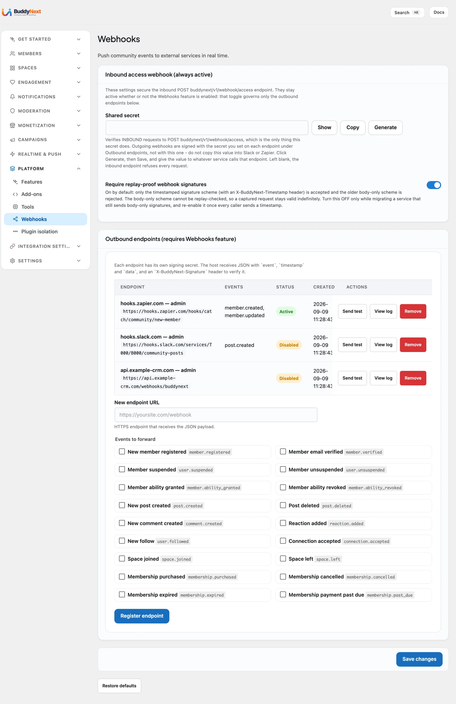

# REST: Webhooks

BuddyNext exposes two webhook surfaces: an outbound CRUD surface that registers external endpoints the site POSTs lifecycle events to, and a single signed inbound endpoint that lets a trusted external service manage a user's role, abilities, and credits. This page covers both. The namespace, auth header, envelope, and error shape are defined on the REST Contract page - read it first.



## Overview / Contract

The outbound webhook feature is an opt-in feature (`webhooks`, plan `opt_in`, group `integrations`). It is off by default. The owner enables Webhooks in Settings before the CRUD routes register: `REST/Router.php` only registers the outbound CRUD controller when `features->is_enabled( 'webhooks' )` is true. Until then, `/webhooks*` is not on the wire and the admin screen shows a "Webhooks are turned off" notice.

Free caps a site at 1 registered outbound endpoint. The cap is applied at registration time via the `buddynext_outbound_webhook_limit` filter (default `1`), checked against all rows in `bn_outbound_webhooks` (active or inactive). Exceeding it returns a 422 `webhook_limit_reached`. Pro lifts the cap by returning a higher integer (or `PHP_INT_MAX`) from the filter.

The outbound CRUD routes all require the `manage_options` capability. The inbound access endpoint is unauthenticated at the nonce layer (`permission_callback => '__return_true'`) and instead verifies an HMAC-SHA256 signature inside the handler.

## Route table

| Method | Path | Auth | Purpose |
|---|---|---|---|
| GET | `/buddynext/v1/webhooks` | `manage_options` | List all registered outbound endpoints |
| POST | `/buddynext/v1/webhooks` | `manage_options` | Register a new endpoint (returns id + signing secret) |
| PUT | `/buddynext/v1/webhooks/{id}` | `manage_options` | Update an endpoint (`url`, `events`, `is_active`, or rotate `secret`) without delete+recreate |
| DELETE | `/buddynext/v1/webhooks/{id}` | `manage_options` | Delete an endpoint and its delivery log |
| GET | `/buddynext/v1/webhooks/{id}/log` | `manage_options` | Paginated delivery log (`per_page` max 100, `page`) |
| POST | `/buddynext/v1/webhooks/{id}/test` | `manage_options` | Send a test ping to the endpoint |
| POST | `/buddynext/v1/webhook/access` | HMAC-SHA256 signature | Inbound: manage a user's role, abilities, or credits |

> **Note:** The outbound routes are plural (`/webhooks`). The inbound access endpoint is singular (`/webhook/access`) and is a different surface with a different auth model. They are not gated by the `webhooks` opt-in feature in the same way - the access endpoint registers whenever its controller boots, but every request must carry a valid signature, and it returns 503 if no secret is configured.

## Outbound: register and manage endpoints

`POST /webhooks` accepts:

| Param | Type | Required | Notes |
|---|---|---|---|
| `url` | string | yes | Must begin with `https://` and be a valid URL, or the call returns 422 `invalid_url` |
| `secret` | string | no | HMAC signing secret. Omit it and the server generates a 40-character secret and returns it once |
| `events` | array of string | no | Event slugs to subscribe to. Empty (the default) subscribes to all events |

The signing secret is returned in the create response and is the only time the generated value is shown. Outbound deliveries are signed with HMAC-SHA256 using this secret and sent off-request; a delivery that fails is retried with exponential backoff, and an endpoint that accumulates three consecutive failures is automatically deactivated.

`PUT /webhooks/{id}` updates an existing endpoint in place. Send only the fields you want to change - any of `url`, `events`, `is_active` (re-enable a deactivated endpoint), or `secret` (rotate the signing secret). It returns `{"success": true, "id": <id>}`.

### Request/response example

Register an endpoint:

```bash
curl -X POST 'https://example.com/wp-json/buddynext/v1/webhooks' \
  -H 'X-WP-Nonce: 5f3a9c2b1d' \
  -H 'Content-Type: application/json' \
  --cookie 'wordpress_logged_in_...=...' \
  -d '{
    "url": "https://hooks.example.net/buddynext",
    "events": ["post.created", "user.followed"]
  }'
```

Success response (201) - note the one-time secret:

```json
{
  "id": 7,
  "secret": "n3vMq1Xk7pR2sT9bL0cZ8dF4gH6jK1mN5wA3eY2"
}
```

Registering a second endpoint on Free (cap reached) returns 422:

```json
{
  "code": "webhook_limit_reached",
  "message": "You have reached the maximum number of registered webhook endpoints.",
  "data": { "status": 422 }
}
```

### Delivery log and test ping

`GET /webhooks/{id}/log` returns the paginated per-attempt delivery log (`per_page` defaults to 20, max 100; `page` defaults to 1). `POST /webhooks/{id}/test` sends a test ping and returns:

```json
{
  "success": true,
  "message": "Test ping delivered successfully."
}
```

A failed test ping returns the same shape with `"success": false` and a 502 status, pointing the caller at the delivery log.

## Inbound: the access endpoint

`POST /webhook/access` lets a trusted external service (a billing system, or a Make, Zapier or n8n scenario that runs after a payment) change a BuddyNext user's access.

### Signing a request

Every request carries two headers:

| Header | Value |
|---|---|
| `X-BuddyNext-Timestamp` | The current Unix time. Seconds are expected; a 13-digit millisecond value (JavaScript `Date.now()`) is accepted and divided. |
| `X-BuddyNext-Signature` | The HMAC-SHA256 hex digest of the string `{timestamp}.{raw body}`, made with the shared secret in the `buddynext_webhook_secret` option (set on the admin settings page). `sha256=<hex>` and bare `<hex>` are both accepted, in upper or lower case. |

Sign the exact timestamp value you send and the exact bytes of the body. The request must arrive within 300 seconds of the timestamp, and a signature that has already been processed is refused, so a captured request cannot be replayed. A plain token or bearer header is not accepted.

In a Zapier "Code by Zapier" (JavaScript) step or a Make custom function the signature is the same three lines:

```js
const crypto = require('crypto');
const timestamp = Math.floor(Date.now() / 1000).toString();
const body = JSON.stringify({ action: 'grant_ability', user_email: email, ability: 'tier:pro', idempotency_key: paymentId });
const signature = crypto.createHmac('sha256', secret).update(timestamp + '.' + body).digest('hex');
// Send `body` unchanged with X-BuddyNext-Timestamp: timestamp and X-BuddyNext-Signature: signature.
```

### Outcomes

- No secret configured: 503 `webhook_not_configured`.
- No `X-BuddyNext-Timestamp` header: 401 `timestamp_required`. Body-only signatures are refused by default; a site still migrating senders can accept them by setting the `buddynext_webhook_strict_signatures` option to `0` or returning false from the `buddynext_require_signed_timestamp` filter (each such call is logged as deprecated).
- Timestamp outside the window: 401 `stale_request`.
- Signature already used: 409 `replayed_request`.
- Signature mismatch: 401 `invalid_signature`.
- Body is not valid JSON: 400 `invalid_payload`.
- `user_id` and `user_email` both sent and not the same member: 400 `identity_conflict`.
- User cannot be resolved: 404 `user_not_found` (unless the request may create the member, see below).
- Action switched off, by the owner (`set_role` is off unless allowed) or through `buddynext_access_webhook_actions`: 403 `action_not_allowed`. The filter receives the owner's list and has the last word. While role changes are off, `grant_ability` also refuses an ability the role map keeps for moderators or admins (for example `buddynext-profile/edit-any`), with the same 403: a staff power granted by hand is a role change by another name. Plans (`tier:<slug>`) and your own custom abilities are not affected.
- Another request for the same member is still running: 409 `busy`. Requests for one member are processed one at a time, so parallel or retried grants cannot create two plans.
- Unknown `action`: 400 `unknown_action`.
- `expires_at` unreadable or in the past: 422 `invalid_expires_at`.
- Credit `amount` missing, negative, not a whole number: 400 `invalid_amount`.
- With BuddyNext Pro, `tier:<slug>` for a plan that does not exist: 422 `unknown_plan`. Nothing is written.

The target user is resolved from `user_id` or `user_email` in the body. Every call that passes the signature check, success or error, is written to `bn_webhook_log` for auditing with the member's email masked. The log follows the site's log retention setting and is included in the member's personal data export and erasure.

### A buyer with no account yet

Off by default. Switch on **Create an account for a new buyer** on the Webhooks screen (option `buddynext_webhook_create_members`) when payment is taken in another tool and the buyer may never have signed up.

With it on, a request that names an email address with no account creates the member first and then runs the action:

- Only `grant_ability` (including `tier:<slug>` with Pro) and `add_credits` create a member. `revoke_ability`, `set_role`, `set_credits` and `deduct_credits` still answer 404.
- Only by `user_email`. A `user_id` that does not exist answers 404. An optional `name` becomes the display name.
- Only on the timestamped signature. A body-only signature (strict signatures switched off) never creates anyone.
- The member gets the site's default role for new members, never a higher one, and an email with a link to set their password on the community's own screen. No other email is sent.
- The answer carries `"member_created": true` and the new `user_id`.
- If the action fails (an unknown plan, a bad date), no account is left behind and no email goes out.
- Blocked email domains are still refused. The registration mode, the terms tick-box and required profile fields are not asked: nobody is filling in a form. The member completes their profile in onboarding at first sign-in.
- Two copies of the same purchase arriving together create one member.

### Actions

| `action` | Effect |
|---|---|
| `set_role` | Set the community role (`admin`, `moderator`, or `member`); fires `buddynext_role_changed`. **Off by default from 1.2.5**: answers 403 `action_not_allowed` until the owner switches on **Allow role changes from outside** on the Webhooks screen (option `buddynext_webhook_allow_set_role`). |
| `grant_ability` | Grant a BuddyNext ability; fires `buddynext_ability_granted`. See the expiry rules below |
| `revoke_ability` | Remove a granted ability; fires `buddynext_ability_revoked` |
| `add_credits` | Add `amount` to the user's credit balance |
| `set_credits` | Replace the user's credit balance with `amount` |
| `deduct_credits` | Subtract `amount` (floors at 0) |
| `grant_plan` | Give a membership plan: `plan` is the plan's slug. The same as `grant_ability` with `tier:<plan>`, with the same expiry rules (BuddyNext Pro) |
| `extend_plan` | Move a plan's end date: `plan` and a new `expires_at` (required). A plan cancelled at period end becomes active again (BuddyNext Pro) |
| `cancel_plan` | End a plan at the end of the period the member already has (default), or now with `"at_period_end": false` (BuddyNext Pro) |

One secret authorises every action. A site that only sells plans can drop the rest:

```php
add_filter( 'buddynext_access_webhook_actions', fn( array $actions ) => array( 'grant_ability', 'revoke_ability' ) );
```

### When a grant ends

| `expires_at` | Result |
|---|---|
| ISO 8601 with a time (`2027-01-31T00:00:00Z`, offsets allowed) | That moment, stored in UTC |
| A date only (`2027-01-31`) | The end of that day, UTC, so the member keeps the last day |
| Unix seconds or milliseconds, as a number or a string | That moment |
| Anything else, or a moment in the past | 422 `invalid_expires_at`, nothing is granted |
| Left out | The ability never ends. With BuddyNext Pro a plan (`tier:<slug>`) runs for its own period instead: a month, a year, or for ever for a one-time plan |
| Left out, with `"lifetime": true` | Never ends, for a plan too |

`amount` for the three credit actions is required and must be a whole number, zero or more, as a number or a digit string.

### Retries: `idempotency_key`

Send an `idempotency_key` (the payment or order id is a good one) with any action. A second request for the same member and action with the same key within 24 hours changes nothing and returns the first answer with `"replayed": true`. The same key with a different request (another amount, ability, role or date) is a mistake in the sender and answers 409 `idempotency_conflict`. Without a key, a tool that retries a request signs it again and `add_credits` is applied twice.

### Plans (BuddyNext Pro)

Grant a plan with the ability `tier:<plan slug>`. A repeat grant extends the member's existing plan instead of creating a second one. `revoke_ability` ends every live row of that plan; when the plan is billed by a gateway on this site (Stripe, PayPal) the gateway is asked to stop billing first, and a refusal raises a billing alert for the owner.

#### Plan actions

`grant_plan`, `extend_plan` and `cancel_plan` name what a payment tool does, so a Make or Zapier scenario does not have to build the `tier:<slug>` ability itself. They run through the same checks as the ability actions (signature, one request per member at a time, `idempotency_key`, member creation, the log), and a site that switched `grant_ability` off has switched `grant_plan` and `extend_plan` off too.

- `grant_plan` and `extend_plan` answer like `grant_ability`, with `"action"` set to what you sent. `extend_plan` without `expires_at` answers 400 `missing_expires_at`; any plan action without `plan` answers 400 `missing_plan`.
- `cancel_plan` keeps access until the plan's end date and stops it renewing: a plan billed by Stripe or PayPal on this site is cancelled with the provider first (as when the member cancels), a plan granted by your tool is simply set to end. It answers `{ "plan": "pro", "subscription_id": 318, "status": "cancelled", "access_until": "2027-01-31T23:59:59Z" }`. Repeating it changes nothing. A member without that plan answers 404 `no_plan`. With `"at_period_end": false` the plan ends now, exactly as `revoke_ability`.

Send the payment with a grant and it is kept on the member's plan, shown on Monetization > Subscriptions (for example "Order order-1001 · $19.00"), so a payment can be matched to a member for support and refunds:

| Field | Rule |
|---|---|
| `reference` | Your order or payment id, up to 191 characters |
| `amount` | The amount paid, a number of 0 or more (400 `invalid_amount` otherwise) |
| `currency` | Three-letter code such as `USD` (400 `invalid_currency` otherwise) |

The latest grant's values are kept. They are not counted as revenue (BuddyNext did not take the money), and a plan billed here keeps its own provider's details.

Send `"source": "make"`, `"zapier"` or `"n8n"` and the plan is recorded as coming from that tool. These are declared by default as non-billing sources, so the plan stays out of this site's revenue figures (the other system took the payment). Any other source must be declared through `buddynextpro_integration_subscription_sources`; an undeclared one is recorded as `manual`.

### Request/response example

```bash
BODY='{"action":"grant_ability","user_email":"member@example.com","ability":"tier:pro","expires_at":"2027-01-31","source":"zapier","idempotency_key":"order-1001"}'
TS=$(date +%s)
SIG="sha256=$(printf '%s.%s' "$TS" "$BODY" | openssl dgst -sha256 -hmac "$WEBHOOK_SECRET" | awk '{print $2}')"

curl -X POST 'https://example.com/wp-json/buddynext/v1/webhook/access' \
  -H "X-BuddyNext-Timestamp: $TS" \
  -H "X-BuddyNext-Signature: $SIG" \
  -H 'Content-Type: application/json' \
  -d "$BODY"
```

Success response (200). `success`, `action` and `user_id` are always present; the rest depends on the action (`role`, `ability` and `expires_at`, or `balance`). The plan fields come from BuddyNext Pro:

```json
{
  "success": true,
  "action": "grant_ability",
  "user_id": 42,
  "ability": "tier:pro",
  "expires_at": "2027-01-31T23:59:59Z",
  "plan": "pro",
  "subscription_id": 318,
  "has_plan": true,
  "source": "zapier"
}
```

A credit action answers with the new balance: `{ "success": true, "action": "add_credits", "user_id": 42, "balance": 150 }`.

### Filters

| Filter | Arguments | Use |
|---|---|---|
| `buddynext_access_webhook_actions` | `string[] $actions` | The actions this site accepts |
| `buddynext_access_webhook_pre_action` | `WP_Error|null $refusal, string $action, int $user_id, array $body` | Return a `WP_Error` to refuse an action before anything is written |
| `buddynext_access_webhook_default_expiry` | `int $expires_ts, string $ability, int $user_id, array $body` | When a grant with no `expires_at` ends (Unix time, 0 for never) |
| `buddynext_access_webhook_response` | `array $response, string $action, int $user_id, array $body` | Add to the success response |
| `buddynext_access_webhook_cancel_plan` | `array|WP_Error|null $result, int $user_id, string $ability, array $body` | Answer a period-end `cancel_plan` (BuddyNext Pro does); null means plans are not available (501) |

Action `buddynext_access_webhook_completed( string $action, int $user_id, array $body, array $response )` fires after an action succeeded (not on a replayed retry); BuddyNext Pro uses it to keep the payment fields.

The Webhooks screen shows the endpoint address, a request to copy as a starting point, and the last ten requests with what was asked, for whom, from which tool and whether it was done.

> **Runnable snippet:** limiting a payment scenario to the plan actions and keeping the order reference on the member (`buddynext_access_webhook_actions`, `buddynext_access_webhook_completed`) is in [`buddynext/buddynext-snippets`](https://github.com/buddynext/buddynext-snippets) at `integrations/limit-access-webhook-actions.php`. Its header says what to change and how it was checked.

## Notes / gotchas

- The generated outbound `secret` is shown only in the `POST /webhooks` response. Store it on creation; it is not returned again by `GET /webhooks`.
- The outbound CRUD routes only exist when the `webhooks` opt-in feature is enabled. If the routes 404, confirm the feature is turned on in Settings before debugging auth.
- Free is capped at 1 outbound endpoint. To raise the cap in Pro or a custom build, return a higher integer from `buddynext_outbound_webhook_limit`.
- The inbound `/webhook/access` endpoint signs over `{timestamp}.{raw body}`. Compute the HMAC on the exact bytes you send - any re-serialization (whitespace, key reordering) changes the signature and produces a 401.
- The two surfaces use different secrets: outbound deliveries are signed with the per-endpoint secret returned at registration; inbound requests are verified against the single `buddynext_webhook_secret` option.

## If your system runs inside this WordPress install

The `/webhook/access` endpoint is the door for a system that cannot run PHP in your process - a hosted CRM, a separate site, a payment platform calling in over HTTP.

A WordPress plugin on the same install should not use it. It would be signing an HTTP request to itself, and it would still have to declare its source, answer for its own name, supply a management URL and survive being deactivated. All of that is already written.

Extend `AbstractGrantBridge` instead - see [Membership Grant Bridges](53-membership-grant-bridges.md). It fires the same grant contract this endpoint fires, so the two doors land in exactly one place and cannot behave differently.

One thing to know if you fire `buddynext_ability_granted` directly rather than through either door: the `$source` argument is honoured **only for a source declared** through `buddynextpro_integration_subscription_sources`. An undeclared source is silently recorded as `manual`, which tells the member their membership was comped and points their Cancel and Manage controls at the wrong system. The grant itself works, so nothing fails and nobody notices.
