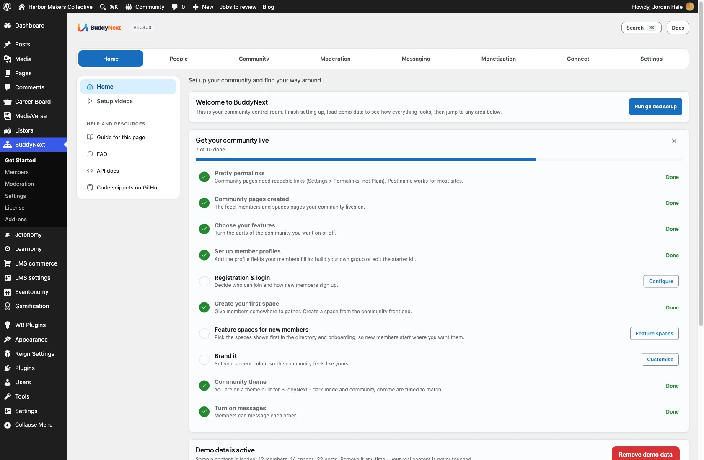

# Cron and Async Jobs

This page covers BuddyNext's scheduled jobs and background-work model: the recurring and single-shot cron hooks in Free and Pro, the Action Scheduler fan-out pattern used for heavy per-member work, and the cron policy every host must respect. Read it before adding a new scheduled job or wiring a new write fan-out.



## Overview / Contract

BuddyNext is built to be fast on a vanilla install with zero server changes. Three rules govern every scheduled job:

1. **Pick the lightest mechanism that fits.** Derivable data is computed lazily and cached - no job. Event responses use a single-shot async action. Only genuinely always-on work (digests, retries, reconciles) uses a recurring schedule, at the lowest acceptable cadence.
2. **Action Scheduler first, WP-Cron fallback.** When Action Scheduler is present, recurring and async actions run through it under the `buddynext` group so they are observable and retryable in Tools > Scheduled Actions. When it is absent, the same hooks run on WP-Cron.
3. **Never force-disable WP-Cron.** The plugin never defines `DISABLE_WP_CRON` and never requires a system cron to be fast. See Cron policy below.

This page documents the jobs that exist today and the rules an add-on follows when it adds its own.

## Scheduled jobs (Free)

Free registers a set of recurring maintenance jobs plus a handful of reactive single-event hooks. Handlers are plain `add_action` callbacks - Action Scheduler and WP-Cron both fire the same hook name.

### Recurring jobs

Registered on `wp_loaded` by `Core\CronScheduler` under the Action Scheduler group `buddynext` (WP-Cron fallback when AS is absent), except where a different registrar is noted.

| Hook | Schedule | What it does |
|---|---|---|
| `buddynext_daily_digest` | Daily | Sends the daily activity digest. |
| `buddynext_weekly_digest` | Weekly | Sends the weekly activity digest. |
| `buddynext_purge_logs` | Daily | The one daily retention job. It age-purges read notifications, `bn_email_log`, the webhook delivery logs and stale presence rows, in batches. The window is the `buddynext_log_retention_days` option (30, 60 or 90 days, default 60); unread notifications are kept until a hard maximum of 90 days. The same run prunes expired auth and verification tokens, closed `bn_reports` rows past the data-retention window, and BuddyNext's own finished Action Scheduler rows (see Extending below). Pro's analytics prune runs on it too. Each listener keeps its own time budget, so a large backlog in one cannot starve another. Registered by `Core\LogRetentionService` on `init`, group `buddynext`. |
| `buddynext_recount_stats` | Daily | Reconcile pass for counters. Counters are maintained incrementally on every write; this only repairs drift. |
| `buddynext_daily_queue_check` | Daily | Sweeps the moderation queue for items needing a daily reconcile (aging reports, expiring strikes). Registered by the moderation listener. |
| `buddynext_publish_scheduled_sweep` | Hourly | Safety sweep that publishes any scheduled post whose time has passed. Registered by `Feed\ScheduledPostsPublisher` on WP-Cron (no Action Scheduler group). |

### Single-event / reactive hooks

Armed on demand and self-clearing - they do not poll when there is no work.

| Hook | When it fires | What it does |
|---|---|---|
| `buddynext_finish_upgrade` | After a schema upgrade made by a request outside wp-admin | Runs the one-time data migrations that upgrade left owing, under the upgrade lock. The next wp-admin load runs them if no runner has. |
| `buddynext_publish_scheduled` | Armed at the next due scheduled post's time (WP-Cron single event) | Publishes due scheduled posts, then re-arms for the next one (or stays disarmed). Free-owned - runs with Pro absent. |
| `bn_onboarding_nudge_24h` | Single action, 24h after signup | Sends the first onboarding nudge to a member who has not finished the setup steps. Armed per user at registration, and armed again after an update or reactivation only for members whose 72-hour window is still open (a member who signed up more than 72 hours ago never gets a late nudge). Self-clears once onboarding completes. |
| `bn_onboarding_nudge_72h` | Single action, 72h after signup | Sends the second onboarding nudge if the member is still incomplete at 72 hours. Same arming model as the 24h nudge. |
| `buddynext_reindex_all_cron` | Single event, 30 seconds after a rebuild is requested | WP-Cron fallback for a full rebuild of the `bn_search_index` table (members, posts, spaces, hashtags), used when Action Scheduler is absent. With Action Scheduler the same rebuild runs as the async `buddynext_reindex_all` action. |
| `buddynext_webhook_deliver` | Single action, per outbound dispatch | Delivers the outbound webhooks for one event off-request. Enqueued async (Action Scheduler, group `buddynext`) when an event fires; `buddynext_webhook_deliver_one` delivers a single webhook the same way. The job carries the event payload: it is what was promised to the receiver. |
| `buddynext_space_delete_chunk` | Single action, while a Space deletion runs | Removes one chunk of a hidden Space's posts and queues the next before it works, so a killed process never ends the chain. Args: `$space_id, $user_id`. |
| `buddynext_space_drive_media_trash` | Single action, after a Space is deleted | Trashes the Space drive's photos, videos and audio, 100 a run, continuing after the last media id it saw. Args: `$space_id, $after_id, $blocked`. |
| `buddynext_webhook_retry_single` | Single event, per failed delivery | Retries a failed webhook delivery with exponential backoff (300s base, up to 3 attempts). |
| `edd_sl_sdk_weekly_license_check_{slug}` | Weekly | License-validation check from the bundled EDD Software Licensing SDK. Gates plugin updates only, never functionality. |

> **Note:** `buddynext_cleanup_tokens` and `buddynext_cleanup_reports` (since 1.3.0, now part of `buddynext_purge_logs`), `buddynext_cleanup_notifications`, `buddynext_cleanup_activity_log` and `buddynext_cleanup_email_log` are retired. The constants remain on `CronScheduler` only so that an upgrade can unschedule them where they are still armed; nothing listens to them.

> **Note:** There is no recurring webhook-retry poll. Outbound delivery uses single events (`buddynext_webhook_deliver` / `buddynext_webhook_retry_single`) scheduled per delivery with exponential backoff, so nothing polls when the queue is empty. The old custom sub-hour recurrences (`buddynext_1min`, `buddynext_5min`, `buddynext_30min`) were removed in the cron-minimisation pass - every remaining recurring job uses a built-in `daily` / `weekly` / `hourly` recurrence.

## Scheduled jobs (Pro)

Pro adds its own jobs in its own Action Scheduler groups (`buddynextpro`, `buddynext-pro`, `buddynextpro_email`, `buddynextpro_push`, `buddynextpro_analytics`, `buddynextpro_bulk_mod`, `buddynextpro_ai_moderation`), so each can be observed and cancelled independently in Tools > Scheduled Actions. Since 1.3.0 Pro's integration jobs (Eventonomy and Listora card rebuilds, the Learnomy Space revoke) also queue in `buddynextpro`; rows queued in `buddynext` by an earlier version still run and are cleared by Pro's deactivation and uninstall. The Learnomy course backfill (`buddynext_space_link_backfill_chunk`) stays in `buddynext`: its hook and listener are Free's.

| Hook | Schedule | Group | What it does |
|---|---|---|---|
| `buddynextpro_broadcast_send_pending` | One single action at the next due time | `buddynextpro_email` | Sends the next batch of an email broadcast. Handled by `Email\BroadcastService`; at most one pending tick, scheduled for when the next send or scheduled campaign is due, and none when there is nothing to send. |
| `buddynextpro_drip_tick` | One single action at the next due time | `buddynextpro_email` | Sends due drip emails, paging enrollments by id with a cursor. Handled by `Email\DripEnrollmentService` / `Email\DripService`; schedules its next tick for the earliest next due email, re-arms on a new enrollment or opt-out change, and stays empty when no enrollments are active. |
| `buddynextpro_expire_subscriptions` | Daily | `buddynextpro` | Expires membership subscriptions past their end date, then fires `buddynextpro_membership_daily`, where the renewal reminders and the grant-bridge reconcile run. Handled by `Membership\SubscriptionService`. |
| `buddynextpro_ai_mod_sweep` | Configurable cadence (from the AI-moderation settings) | `buddynextpro_ai_moderation` | AI-moderation sweep over the pending report queue, paged up to the per-run cap. Handled by `Moderation\AiModerationSweep`. |
| `buddynextpro_renewal_reminders` | Single action, only when a sweep stops part way | `buddynextpro` | Continues a renewal-reminder pass (args: cursor). The daily pass runs on `buddynextpro_membership_daily`. |
| `buddynextpro_grant_sweep_continue` | Single action, only when the daily grant sweep runs out of its 20 seconds | `buddynextpro` | Continues the membership grant reconcile at the bridge and page it reached (args: bridge class, offset). |

> **Note:** since 1.3.0 `buddynextpro_reconcile_memberships` and the recurring `buddynextpro_renewal_reminders` run inside `buddynextpro_membership_daily`, and `buddynextpro_data_retention` runs inside Free's `buddynext_purge_logs`. The upgrade routine cancels their old recurring actions once. `buddynextpro_ai_mod_cleanup` is retired the same way.

> **Note:** Pro does not register its own scheduled-post publish cron. Publishing is Free-owned - `Feed\ScheduledPostsService` delegates the actual publish to Free's `Feed\ScheduledPostsPublisher` (the `buddynext_publish_scheduled` single event above).

## The Action Scheduler fan-out pattern

Some events touch many rows. When a member posts in a space with 100,000 members, naively inserting 100,000 notification rows inside the request would time the request out. BuddyNext caps the synchronous cost and pages the rest through Action Scheduler.

The pattern, as implemented for new-space-post notifications:

1. The triggering request processes a **first bounded batch** synchronously (a keyset query limited to `SPACE_FANOUT_BATCH` members). Small spaces finish here with no background job at all.
2. If a full batch came back, more members remain. The request enqueues an async action, resuming from the last processed `user_id` (keyset, never `OFFSET`):

```php
if ( function_exists( 'as_enqueue_async_action' ) ) {
    as_enqueue_async_action(
        'buddynext_async_space_post_fanout',
        array(                                   // positional args: one, the payload array
            array(
                'post_id'       => $post_id,
                'space_id'      => $space_id,
                'author_id'     => $author_id,
                'after_user_id' => $after_user_id, // keyset cursor
            ),
        ),
        'buddynext' // group
    );
}
```

Action Scheduler spreads the args array into the callback's parameters, so a payload you want to arrive as one array goes inside a one-element list, as above. An associative array passed directly would arrive as separate parameters.

3. The worker processes one bounded batch, then **re-enqueues itself** for the next page until the roster is exhausted. Neither the request nor any single scheduled action ever loads or loops the whole roster.
4. When Action Scheduler is absent (local/test), the worker drains the remaining batches inline, still bounded to one batch per query, so every member is still notified.

Hashtag indexing follows the same shape on a smaller scale. When a post is created or its content is edited, the hashtag listener queues `buddynext_async_index_hashtags` with the post id only; the job reads the saved content when it runs, so it never indexes text that changed after it was queued, and a post that is deleted by then is skipped:

```php
// includes/Hashtags/HashtagListener.php
\BuddyNext\Core\CronScheduler::enqueue_once( 'buddynext_async_index_hashtags', array( 'post', $post_id ) );
```

Content from another plugin, passed with its text on `buddynext_index_hashtags( $object_type, $object_id, $content )`, is extracted at once instead of being copied into a job.

### Async hooks you can extend

| Hook | Fired when | Args |
|---|---|---|
| `buddynext_async_space_post_fanout` | A space post needs background notification fan-out (RECORD stage) beyond the first batch | one arg: `array{ post_id, space_id, author_id, after_user_id }` |
| `buddynext_async_space_post_emails` | DELIVER stage: emails one fan-out page, 50 members per action, off the fan-out task | `int $post_id, int $space_id, int $author_id, int $after_id, int $to_id, string $type, int $cursor` (since 1.3.0; earlier jobs carried one payload array with the recipient list) |
| `buddynext_async_index_hashtags` | A post was created or its content edited; the job reads the saved content when it runs | `'post', int $post_id` (since 1.3.0; a job queued by 1.2.x for other content still carries its text as a third arg and is indexed from it, until 1.4.0) |
| `buddynext_reindex_all` | A full search-index rebuild is requested | none |
| `buddynext_async_index_post` | A post is created or edited and needs indexing | `int $post_id, int $user_id` |
| `buddynext_async_deindex_post` | A post is removed from search | `int $post_id` |
| `buddynext_async_index_space` | A space is created or edited and needs indexing | `int $space_id` |
| `buddynext_async_deindex_space` | A space is removed from search | `int $space_id` |
| `buddynext_async_reindex_space_posts` | A space's posts need re-indexing (self-paginating) | `int $space_id, int $offset` |
| `buddynext_async_index_user` | A member's profile changed and needs indexing | `int $user_id` |
| `buddynext_async_fetch_link_meta` | A post with a link needs its preview fetched | `int $post_id` |
| `buddynext_async_send_invite_email` | An invitation email is queued | `int $invite_id` (since 1.3.0; the worker reads the invite, so no token is stored in the job) |
| `buddynext_async_announcement_fanout` | An announcement needs notification fan-out | `array` |
| `buddynext_send_notification_email` | A notification email is sent off-request | `int $user_id, string $notification_type, array $data` |
| `buddynext_retry_notification_email` | A failed notification email is retried | `int $user_id, string $notification_type, array $data` |
| `buddynext_resync_hashtags` | A batched hashtag re-sync runs | `int $offset` |
| `buddynext_recount_hashtags` | A batched hashtag usage recount runs | `int $after_id` |
| `buddynext_regen_article_crops` | One-time pass after the 1.3.0 upgrade: cuts the article cover and thumbnail crops for published articles' featured images, 20 posts a batch, then purges the page cache once if anything changed | `int $after_post_id, int $changed` |
| `buddynext_mvs_media_activity` | A MediaVerse upload is turned into a feed post, two minutes after the upload | `$media_id, $user_id, $media_type` |

Rules for any new fan-out you add:

- **Your own group.** An add-on queues its jobs in its own group (for example `'my_addon'`) and adds it to `buddynext_finished_action_groups` so the daily purge clears its finished rows. Never queue in `'buddynext'`: Free's deactivation and uninstall treat that group as Free's. Helpers that queue for you take the group as a parameter (`CronScheduler::enqueue_once()`, `ensure_recurring()`, `IntegrationActivity::run_in_chunks()`).
- **Idempotent handlers.** Action Scheduler retries on failure; the handler must tolerate re-running the same batch.
- **Keyset, not OFFSET.** Page with a `last_id` cursor so large rosters never get slower as you page deeper.
- **Cap the synchronous slice.** Do the first bounded batch in-request, only background the remainder.

## Extending the background jobs

### `buddynext_finished_action_retention_days` (filter, since 1.3.0)

Days to keep BuddyNext's completed and canceled Action Scheduler rows (and their logs) before the daily `buddynext_purge_logs` run deletes them. Default `7`; values below 1 count as 1. Failed rows are kept 90 days, then deleted the same way. Pending and running rows, and other plugins' rows, are never touched. A run removes at most 10,000 rows (50 batches of 200) and stops after about 10 seconds; anything left waits for the next day, and Action Scheduler's own cleaner is the backstop.

### `buddynext_finished_action_groups` (filter, since 1.3.0)

The Action Scheduler groups whose completed rows that purge may delete. Default `array( 'buddynext' )`; BuddyNext Pro adds its own groups. An add-on that runs its jobs in its own group adds it here. Never add another plugin's group.

```php
add_filter( 'buddynext_finished_action_retention_days', static fn() => 14 );
add_filter( 'buddynext_finished_action_groups', static function ( $groups ) {
    $groups[] = 'my_addon';
    return $groups;
} );
```

Run on a test site with Pro active, the two filters returned `days=14` and `buddynext, buddynextpro, buddynext-pro, buddynextpro_email, buddynextpro_push, buddynextpro_analytics, buddynextpro_bulk_mod, buddynextpro_ai_moderation, my_addon`.

### `buddynextpro_membership_daily` (action, Pro, since 1.3.0)

Fires once a day inside `buddynextpro_expire_subscriptions`, right after expired subscriptions are closed. No arguments. Daily membership work hooks in here instead of scheduling its own recurring job.

```php
add_action( 'buddynextpro_membership_daily', static function () {
    // Daily membership housekeeping for your add-on.
} );
```

### Queueing a job once: `CronScheduler::enqueue_once()` and `has_pending()`

`\BuddyNext\Core\CronScheduler::enqueue_once( string $hook, array $args, string $group = 'buddynext' ): bool` queues an async action unless an identical one (same hook, args and group) is still pending; it returns `true` when it queued. A running action does not count, so an edit made while the job runs is still picked up. `has_pending( string $hook, ?array $args = null, string $group = 'buddynext' ): bool` is the check on its own (pending only; `null` args match any args). Both return `false` when Action Scheduler is absent, so keep your own fallback.

```php
use BuddyNext\Core\CronScheduler;

CronScheduler::enqueue_once( 'my_addon_reindex', array( 42 ) ); // true: queued
CronScheduler::enqueue_once( 'my_addon_reindex', array( 42 ) ); // false: one already pending
CronScheduler::has_pending( 'my_addon_reindex' );               // true
```

Those are the values a test run returned. Keep args to ids and short scalars: Action Scheduler matches args by their stored JSON, and keys longer than 191 characters are compared by hash.

### Keeping a recurring job armed: `CronScheduler::ensure_recurring()`

`\BuddyNext\Core\CronScheduler::ensure_recurring( string $hook, int $interval, int $first = 0, string $group = 'buddynext' ): int` keeps one recurring job armed. Call it on `wp_loaded`. It does nothing outside the cron runner, wp-admin page loads and WP-CLI (so front-end, REST and AJAX requests never pay for the check), skips when the job is already queued, schedules with Action Scheduler's `unique` flag so two requests arming at once still leave one row, falls back to WP-Cron when Action Scheduler is absent, and returns the new action id (0 when nothing was scheduled).

```php
add_action( 'wp_loaded', static function () {
    \BuddyNext\Core\CronScheduler::ensure_recurring( 'my_addon_daily', DAY_IN_SECONDS, 0, 'my_addon' );
} );
```

### Deactivation: what an add-on cancels and what it keeps

`CronScheduler::cancel_pending( array $groups, array $hooks = array(), array $keep_prefixes = array(), array $keep_hooks = array() ): int` marks your pending jobs canceled in a few queries, whatever the queue size, and never touches another plugin's jobs. Cancel only jobs that can be recomputed or are lost by nature (digests, sends, reindexes, recounts, prunes). Leave pending, by listing them in `$keep_hooks`, the jobs that finish something a member or the site owner already did: a deletion under way, a privacy change still cascading, a promised delivery. The routine update (deactivate, replace files, activate) runs nothing in between, so kept jobs pick up where they stopped. While a plugin stays deactivated, another plugin's Action Scheduler may still run due rows that have no listener and mark them complete, so a long deactivation can lose them.

```php
register_deactivation_hook( __FILE__, static function () {
    wp_clear_scheduled_hook( 'my_addon_daily' );
    \BuddyNext\Core\CronScheduler::cancel_pending( array( 'my_addon' ), array(), array(), array( 'my_addon_delete_continue' ) );
} );
```

BuddyNext itself keeps these on deactivation: a member's GDPR hard delete (`buddynext_purge_member_continue`), a Space deletion and its media trash (`buddynext_space_delete_chunk`, `buddynext_space_drive_media_trash`), a deleted profile field's purge, the upgrade and course-link migrations, privacy-change cascades, forum access grants, sent invites, promised webhook deliveries and the old file of a replaced image. Pro keeps a moderator's bulk action, a sent broadcast's recipient listing and a Learnomy unlink's access revoke. Uninstall deletes all of BuddyNext's jobs.

## Migrating to 1.3.0

Background-job hooks that changed in 1.3.0. Nothing changes for members or site owners; nothing needs setting up.

| Hook | Change | What to do |
|---|---|---|
| `buddynext_cleanup_tokens` | No longer scheduled; the prune runs on `buddynext_purge_logs` (daily). | A listener on the old hook stops firing. Hook `buddynext_purge_logs` instead. |
| `buddynext_cleanup_reports` | No longer scheduled; the prune runs on every daily `buddynext_purge_logs` run instead of weekly. | Same as above. |
| `buddynextpro_data_retention` (Pro) | No longer scheduled; the prune runs on `buddynext_purge_logs`. | Hook `buddynext_purge_logs`. |
| `buddynextpro_reconcile_memberships` (Pro) | No longer scheduled; the reconcile runs on `buddynextpro_membership_daily`. | Hook `buddynextpro_membership_daily`. |
| `buddynextpro_renewal_reminders` (Pro) | No longer a daily recurring action; the daily pass runs on `buddynextpro_membership_daily`. The hook still carries continuations of a pass that stopped part way. | Hook `buddynextpro_membership_daily` for daily work. |
| `buddynext_async_index_hashtags` | Args are `'post', $post_id`; the job reads the saved content. Text passed on `buddynext_index_hashtags` is extracted at once, not queued. | A listener reading a third content arg gets none; read the post instead. |
| `buddynext_async_space_post_emails` | Seven positional args (`$post_id, $space_id, $author_id, $after_id, $to_id, $type, $cursor`) instead of one payload array with a recipient list. Jobs queued earlier still run. | A listener reading the payload array reads the post id and page range instead. |
| `buddynext_async_send_invite_email` | One arg, the invite id, instead of the payload with the invite token. | Read the invite by id. |
| `buddynext_space_delete_chunk` | Args are `$space_id, $user_id` (the chain counter is gone). | A listener with two parameters keeps working. |
| Action Scheduler retention | BuddyNext no longer shortens Action Scheduler's site-wide retention to 14 days (`action_scheduler_retention_period`); it deletes only its own finished rows (7 days, failed 90). | Nothing: other plugins' history is kept for Action Scheduler's default 30 days again. |
| Deactivation | Recomputable jobs are canceled; jobs that finish a committed action stay pending. | An add-on lists its own committed jobs in `cancel_pending()`'s `$keep_hooks`. |
| `buddynextpro_async_index_embedding` (Pro) | Args are `'post', $post_id`, queued once while pending; the job reads the published content. `buddynext_index_embedding` ignores its text for posts and embeds other types at once. | Same as above. |
| `buddynextpro_broadcast_send_pending`, `buddynextpro_drip_tick` (Pro) | Single actions at the next due time instead of a fixed 5-minute / hourly cadence; `buddynextpro_drip_tick` passes `$after_id, $next_due`. | A listener with no parameters keeps working. |
| `buddynext_finished_action_retention_days` | New filter. | Optional. |
| `buddynext_finished_action_groups` | New filter. | Add your own group if your add-on runs its jobs in one. |
| `buddynextpro_membership_daily` (Pro) | New action. | Optional. |
| `CronScheduler::enqueue_once()`, `has_pending()`, `cancel_pending()`, `when_ready()`, `ensure_recurring()` | New public methods. | Optional; see above. |
| `IntegrationActivity::run_in_chunks()` | New trailing `$group` parameter (default `'buddynext'`). | An add-on passes its own group. |
| `buddynext_space_drive_media_trash` | New in 1.3.0. Args are `$space_id, $after_id, $blocked`; each run continues after the last media id it saw. | Nothing. |

Public methods removed in 1.3.0 keep a deprecated stand-in that raises a `_deprecated_function` notice for two major versions. Move to the replacement:

| Removed | Replacement |
|---|---|
| `Auth\AuthController::client_ip()` | `Moderation\SafeguardService::client_ip()` (the stand-in delegates). |
| `Bridges\JetonomyBridge::rest_provision_permission()` | `rest_discussion_manage_permission()` (the stand-in delegates). |
| `Admin\Members::export_members_csv()` | `Admin\Members\MemberExport::export_members_csv()`, which streams. The stand-in returns the same CSV (paged reads, escaped cells) as one string held in memory, about 100 bytes a member; on a very large site stream with `MemberExport` instead. |
| Pro `BroadcastService::deactivate_cron()`, `DripEnrollmentService::deactivate_cron()`, `SubscriptionService::deactivate_cron()`, `RenewalReminderService::deactivate_cron()` | Nothing: Pro's one deactivation handler clears every Pro job. The stand-ins still clear their own job. |
| Pro `RenewalReminderService::ensure_scheduled()`, `GrantBridgeRegistrar::ensure_scheduled()`, `Analytics\RetentionJob::sync_schedule()` | Pro `SubscriptionService::ensure_scheduled()` or Free `LogRetentionService::arm()`. The work now runs inside `buddynextpro_membership_daily` or `buddynext_purge_logs`, and each stand-in schedules that job. |

The old recurring actions are cancelled once by the upgrade routine, so nothing is left firing into an empty hook.

## Cron policy - never force, detect and guide

BuddyNext never changes a site-wide cron setting on the owner's behalf.

- The plugin **never** defines `DISABLE_WP_CRON`. That constant disables WP-Cron for every plugin on the site (backups, WooCommerce, email queues) and silently breaks them if no real system cron is wired.
- Action Scheduler runs fine off WP-Cron by default. Running it off a real system cron is an optional, owner-applied server optimization - never a requirement for BuddyNext to be fast.
- The plugin **detects** the failure case and guides the admin. The Tools health check reports whether WP-Cron is disabled and whether any scheduled actions are overdue. Only when the site is genuinely stalled (WP-Cron off and actions overdue) does it surface a warning with a ready-to-paste system-cron line built from the site's own URL:

```cron
*/5 * * * * wget -q -O - 'https://SITE/wp-cron.php?doing_wp_cron' >/dev/null 2>&1
```

## Notes / gotchas

- **Schedule on `wp_loaded` or `init`, never `plugins_loaded`.** Action Scheduler is not initialized until `init`; an `as_schedule_*` call before that silently no-ops. If you cleared the WP-Cron event first, the job ends up unscheduled entirely. Always verify scheduling happened after the fact.
- **Deactivation.** See "Deactivation: what an add-on cancels and what it keeps" above. BuddyNext's own deactivation cancels its recurring jobs (digests, log retention, the recount, the moderation queue check) and its recomputable one-off jobs, from Action Scheduler and WP-Cron alike; each recurring job re-arms on the first wp-admin load or cron run after the plugin is activated again. Pro does the same for its own groups.
- **Free / Pro boundary.** Pro registers its jobs on its own boot through the same helpers, in its own groups (listed under Scheduled jobs (Pro)); scheduled-post publishing is not a Pro job - Pro delegates it to Free's `ScheduledPostsPublisher`.
- **Pruning.** Action Scheduler's own retention clears completed rows after 30 days; BuddyNext additionally deletes its own completed and canceled rows after 7 days (`buddynext_finished_action_retention_days`) and its failed rows after 90 days so a busy community does not fill `actionscheduler_*` tables.

See also the Scale Contract for the fan-out and indexing rules that shaped these jobs.
