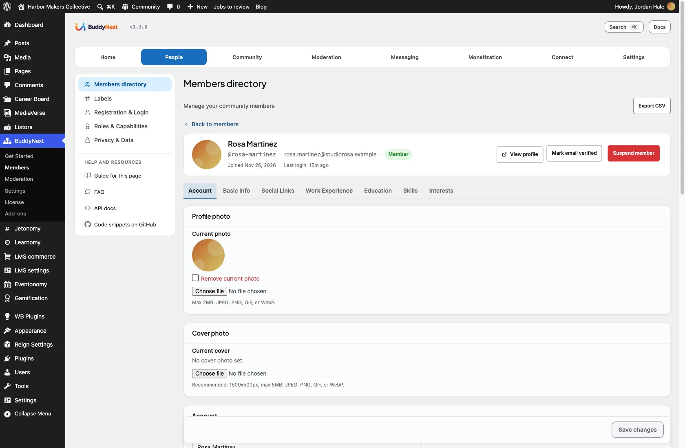

# Editing a Member from the Admin

Every member's account and profile can be opened and changed directly from the admin - their display name, email, role, profile URL, avatar and cover photo, and every custom profile field they have (or have not) filled in. This is separate from a member editing their own profile: it needs the WordPress **manage_options** capability, so only administrators can do it, and it works even when the member cannot or will not fix something themselves.

## Why use it

Support requests are the main reason this exists. A member locked out of their email, unable to clear a bad value from a required field, or asking you to fix a typo in their bio has no way to do any of that themselves if their account is stuck - and you should not have to sign in as them to help. Opening their record from **BuddyNext > Members > Directory** and using **Edit** gives you the same fields they would see on their own Edit Profile screen, from your own admin session.

## Where to find it

Go to **BuddyNext > Members > Directory**, find the member in the list, and select **Edit** in their row's actions (next to **View**, which opens their public profile in a new tab instead).

## What you can change

The edit screen is organized into an **Account** tab plus one tab per profile field group, matching the groups you have built (see [Custom Profile Fields](02-profile-fields.md)).

| Section | What you can change |
|---|---|
| Account - Profile Photo | Upload a new avatar, or remove the current one. Same 2 MB / JPEG, PNG, GIF, or WebP limit as a member's own upload. |
| Account - Cover Photo | Upload a new cover photo, or remove the current one. Same 5 MB limit as a member's own upload. |
| Account - Account | Display name, email address, WordPress role, and the member's profile URL slug (their handle - see [Setting a username](01-member-profiles.md#setting-a-username-your-profile-handle)). |
| Account - Member Type, Membership, Labels | Rendered here by the relevant feature when it is active - see [Member Types](05-member-types.md) for the type dropdown. |
| Each profile field group's tab | Every field in that group, flat or repeater, with the same input control the member sees on their own Edit Profile form. |

Hero actions above the tabs also let you **mark the member's email verified** (see [Email Verification](../accounts-access/04-email-verification.md)) and **suspend or unsuspend** the member, when those features are on.

Selecting **Save Profile** submits everything on the page at once.

## Who can edit what

Editing follows WordPress's own rules for editing a user, so BuddyNext never lets someone change what WordPress would refuse them.

- **On a single site** an administrator can change everything on this screen.
- **On a multisite network**, a site administrator can edit a member's community data (profile fields, photos, member type) but needs WordPress's permission to change the account fields: **email, display name and profile URL** are read-only for them (a short hint says so) unless they hold the matching permission, and the **role** drop-down is disabled unless they may change that member's role. Saving a change they are not allowed to make is refused with a clear message instead of being skipped.
- **A network super admin** can only be edited by another super admin. A site administrator who opens one is told so and nothing is saved.
- **Reserved handles.** An administrator can give a staff account a reserved word such as `support` or `staff` in the **Profile URL** field. Words BuddyNext uses in its own addresses (`me`, `settings`, `edit`, `search`, `new`, `all`, `page`, `admin`) stay blocked for everyone. A member who already holds a reserved word can still be edited for unrelated changes. A refused word is reported as reserved, not as taken.
- **Clearing the Profile URL.** Empty the field and save to drop a custom handle: the member goes back to the default, which is based on their username (or `user-` and their account number when the username has no usable letters). Their old handle keeps reaching their profile. If another member now holds the default, the save is refused and says so. See [Member Profiles](01-member-profiles.md#setting-a-username-your-profile-handle).

## Good to know

- **A photo that cannot be processed is reported.** If the image editor cannot process an avatar or cover, the rest of your edit is still saved and the notice tells you which photo was not. Uploads are checked by the file's real contents, not the type the browser reports.
- **You cannot suspend your own account.** An administrator suspending themselves is refused, and on a network a site administrator cannot suspend a network super admin.

- **The same validation applies.** A save goes through the identical profile-save logic a member's own edit uses - a required field left empty, an out-of-range number, or a malformed value is rejected with the same message, attributed to the same field, rather than silently accepted from the admin screen.
- **The whole save is atomic.** If any field fails validation, nothing on the page is saved - not even the fields that were fine. This avoids a half-written profile that no longer matches what you see on screen. Fix the flagged field and save again.
- **Email and profile-URL changes are checked for conflicts.** An email already used by another account, or a handle already taken, is rejected rather than silently applied - see [Setting a username](01-member-profiles.md#setting-a-username-your-profile-handle) for the handle rules.
- **You edit values, not privacy.** This screen changes what a field holds; it does not change who is allowed to see it. Each field's audience stays whatever the member (or the field's default) has set - see [Custom Profile Fields](02-profile-fields.md).
- **Repeater entries work the same way.** Work Experience, Education, or any repeating group you have built can be edited entry by entry, and new entries can be added, from the group's tab.
- **This is not the same as the WordPress user-profile screen.** wp-admin's own **Users > Edit User** screen still exists and edits the WordPress account directly; this BuddyNext screen is where you edit the community-facing profile the member and everyone else actually sees.

## Exporting members

The **Export CSV** button at the top of **BuddyNext > Members > Directory** downloads every member as a CSV file (ID, login, email, display name, registered date and whether the member is suspended). Because members choose their own display names, a cell that starts with `=`, `+`, `-` or `@` is written with a leading single quote so a spreadsheet shows it as plain text and never runs it as a formula. The moderation log export is written the same way.

## Free vs Pro

Editing a member's account and profile fields from the admin, including avatar and cover management, is part of BuddyNext free. Advanced Pro field types (Location, extended date, advanced number, advanced multi-select) render here with their own input controls once Pro is active, the same as they do on a member's own Edit Profile form - see [Advanced Profile Field Types (Pro)](../pro/09-advanced-profile-fields.md).

## Related

- [Member Profiles](01-member-profiles.md) - the profile a member edits themselves, and the handle rules this screen also enforces
- [Custom Profile Fields](02-profile-fields.md) - the groups and fields that fill each tab
- [Member Types](05-member-types.md) - the type dropdown that appears in the Account tab
- [Email Verification](../accounts-access/04-email-verification.md) - marking a member verified from this same screen
- [Member Directory](04-member-directory.md) - the admin members list this screen opens from
